<p align="center">
  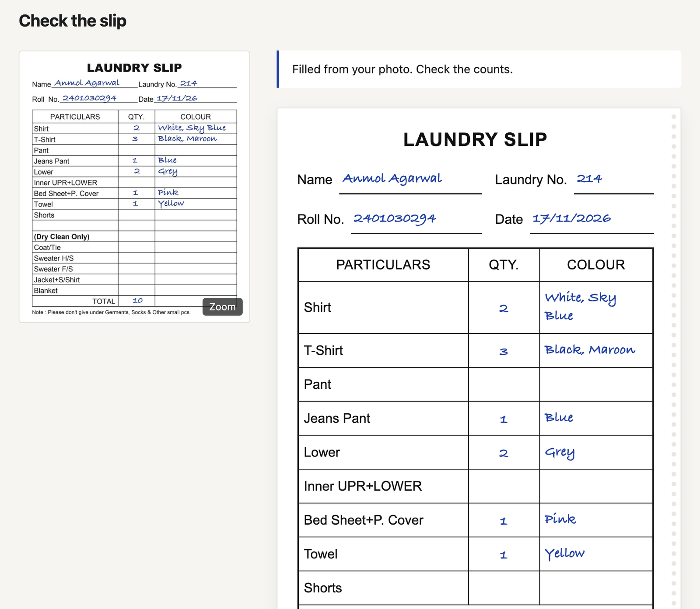
</p>

<p align="center">
  <a href="https://laundrytrackerjiit.vercel.app"></a>
  
  
  
  <a href="LICENSE"></a>
</p>

LaundryTrack turns the paper laundry slip that JIIT hostel students hand in with their clothes into a record they can show later. You photograph the slip, an AI model reads the handwriting into an on-screen copy of the same slip, you check it and confirm, and a confirmation email with the item list, the slip photo and a calendar reminder goes to your institute mailbox. On the day you chose, a reminder email tells you to collect. At the counter you count what came back, and anything short is recorded against that slip.

**Built with** Django and Postgres, Claude Haiku vision for reading the handwriting, and Vercel for hosting and the daily reminder job.

### The problem, and what LaundryTrack does about it

| What goes wrong in the hostel today | What LaundryTrack does |
|---|---|
| Nobody can prove what was handed in: the only record is the paper slip, and it stays with the laundry. | A receipt in the student's own mailbox: the item list plus the photo of the slip, sent the day it is handed in. |
| When an item is missing at pickup, it is the student's word against the counter's. | An item-by-item checklist at pickup, with any shortfall recorded on that slip and emailed as a summary. |
| Students forget what they gave a few days ago. | A digital copy of every slip, kept in one list with its status. |
| Students forget to collect, and bundles sit at the counter. | A reminder email on the date they pick, plus a calendar event for the counter hours. |
| Laundry is taken only on fixed days, and clothes are ready only from the next one. | Each student sets their own laundry days, and the earliest ready date is worked out for them. |

## Try it in 30 seconds

Open **[laundrytrackerjiit.vercel.app](https://laundrytrackerjiit.vercel.app)** on your phone, then:

1. sign up with your name and roll number (the email field is optional; it defaults to `<roll number>@mail.jiit.ac.in`)
2. tap **Upload**, photograph your filled-in laundry slip and tap **Read slip**
3. check the on-screen slip against the paper one, fix anything that was misread, pick the day to be reminded and tap **Confirm**
4. open your institute mailbox: the confirmation email has the item list, a photo of your slip and a calendar file for pickup day

## The problem

In the JIIT hostels, laundry is handed in only on fixed days. For the author those days are Tuesday and Friday. Clothes given on Tuesday are ready from Friday, clothes given on Friday are ready from the next Tuesday, and after that they can be collected on any day while the counter is open, from 4:00 PM to 6:30 PM.

With each bundle the student fills in a printed laundry slip: name, laundry number, roll number, date, and a quantity and colour against rows such as Shirt, T-Shirt, Jeans Pant, Towel and Bed Sheet. The slip goes to the laundry with the clothes.

<p align="center">
  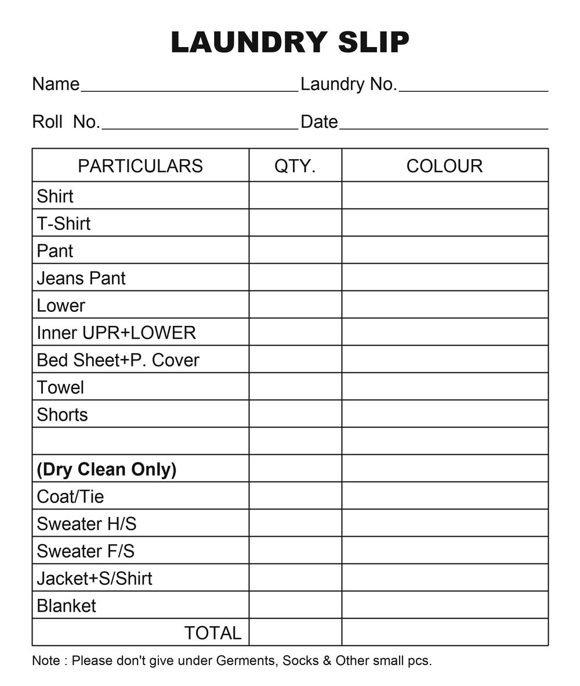
</p>
<p align="center"><sub>The printed slip students fill in by hand, redrawn from the real one.</sub></p>

That is where the record ends. At pickup nobody can prove how many clothes were handed in. A shirt goes missing and the student says there were three while the counter says there were two, and neither side has anything to show. Students also forget what they gave a few days earlier, and forget to collect at all.

LaundryTrack keeps a copy of the slip that the student controls: what was written, when, and a photo of the paper itself in their own inbox. At pickup it turns the slip into a checklist, so a shortfall is written down against that slip at the counter instead of being argued about later.

## How it works, step by step

The screenshots show the author's own account. The slips in them were drawn for this README in the real slip layout, and their laundry numbers and items are sample data.

### 1. Upload a photo of the slip

<p align="center">
  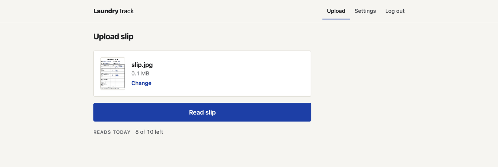
</p>
<p align="center"><sub>The upload page: one photo, one button, and how many slip reads are left today.</sub></p>

You take a photo of the filled-in slip or pick one from the gallery; JPEG, PNG and iPhone HEIC photos all work. The photo is sent to the server once to be read and is deleted as soon as the reading is done. The browser keeps its own copy in the tab (in `sessionStorage`) so it can be shown beside the form on the next page and attached to the confirmation email.

### 2. The slip, read into a digital copy of the same slip

<p align="center">
  
</p>
<p align="center"><sub>The photo beside the same slip as a form. Every printed row is there, in the paper slip's order, so checking it is a row-by-row comparison.</sub></p>

The server sends the photo to Claude Haiku 5.5 with a description of the JIIT slip layout and a JSON schema, and gets back the name, laundry number, roll number, date, and a quantity and colour for every row that has something written in it. Those values fill an on-screen copy of the paper slip: the same header fields, the same printed rows in the same order (including the dry-clean section), and a row for anything written on the blank line.

Only what is written on the slip goes into the form. Nothing is copied in from your account, so a blank slip stays blank and the page says so. The date on the slip is used only if it is plausible (not in the future and at most 14 days old); otherwise the form starts with today's date. You can correct any field, change any row or add one before confirming, and you can zoom into the photo while you compare.

### 3. Confirm, and choose when to be reminded

Under the slip you pick the day for the reminder email. The earliest date allowed is your next laundry day after the date on the slip, because that is when the clothes are ready, and a reminder is never set in the past: for an older slip the earliest date is today. Any later day is fine too, since clothes can be collected on any day after that. The counter hours, 4:00 PM to 6:30 PM, are the same for everyone. Your laundry days are your own: they are set at sign-up and can be changed in **Settings** (Tuesday and Friday by default).

The page also shows where the email will go: the roll number on the slip at `@mail.jiit.ac.in`. A roll number has to be 6 to 15 letters or digits, and at least one item needs a quantity, or the slip cannot be saved.

### 4. The confirmation email

<p align="center">
  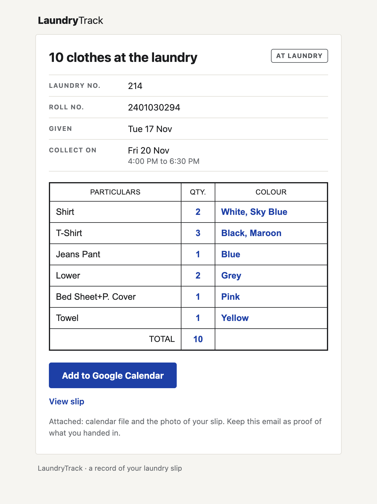
</p>
<p align="center"><sub>The email as written by the local run. Attached to it: <code>laundry-pickup.ics</code> and <code>laundry-slip-214.jpg</code>, the slip photo.</sub></p>

Confirming saves the slip and sends an email to the roll number's institute mailbox with:

- the items, quantities and colours, and the total
- the laundry number, roll number, the day the clothes were given and the day you chose to collect
- a link that adds the pickup to Google Calendar, and a `laundry-pickup.ics` file for Apple Calendar or Outlook, with alerts two hours before the counter opens and when it opens
- the photo of the paper slip, attached, so the proof sits in your inbox and not on the server

On the reminder date a second email arrives with a checklist of what to count at the counter. A slip's page can also send that reminder straight away or resend the confirmation.

### 5. Every slip in one place

<p align="center">
  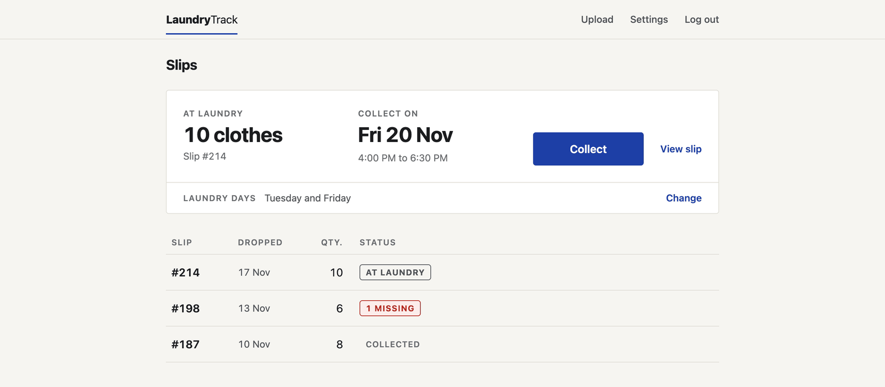
</p>
<p align="center"><sub>Three slips in three states: at the laundry, collected with one item missing, and collected in full.</sub></p>

The Slips page puts the next bundle to collect at the top: how many clothes, which slip, the day to collect and the counter hours, with a button that goes straight to the checklist. Your laundry days are shown under it. Below that is every slip, newest first, with the date it was dropped, the number of clothes and where it stands: at the laundry, overdue, collected, or collected with items missing.

### 6. Collect, and record what is missing

<p align="center">
  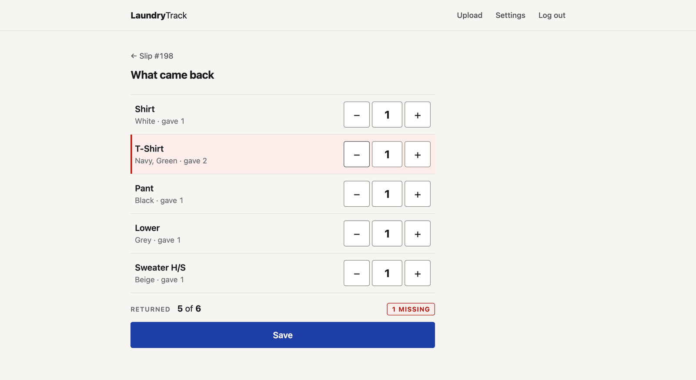
</p>
<p align="center"><sub>At the counter: one row per item, the number given, and the number that came back.</sub></p>

At pickup you open the slip and set how many of each item came back; every row starts at the number given, so a complete bundle is one tap on **Save**. If everything is there, the slip is marked collected. If anything is short, the slip's page shows exactly which rows are short and by how many.

<p align="center">
  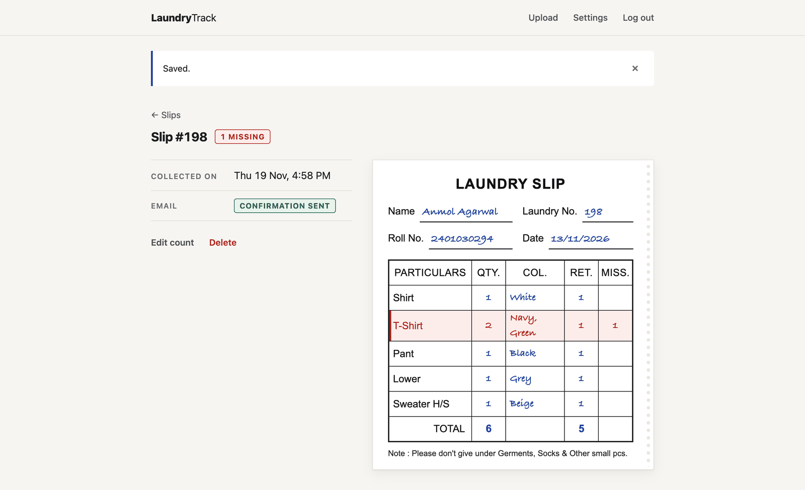
</p>
<p align="center"><sub>One T-shirt short, recorded against the slip it was written on.</sub></p>

A summary email follows either way: "all collected" when the counts match, or a list of given, returned and missing per item when they do not, for showing to the laundry staff together with the slip photo from the first email. A count entered by mistake can be corrected with **Edit count**.

### On a phone

<p align="center">
  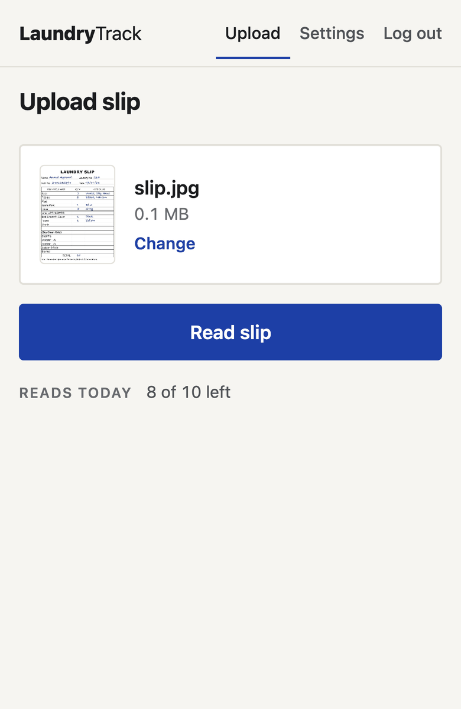
  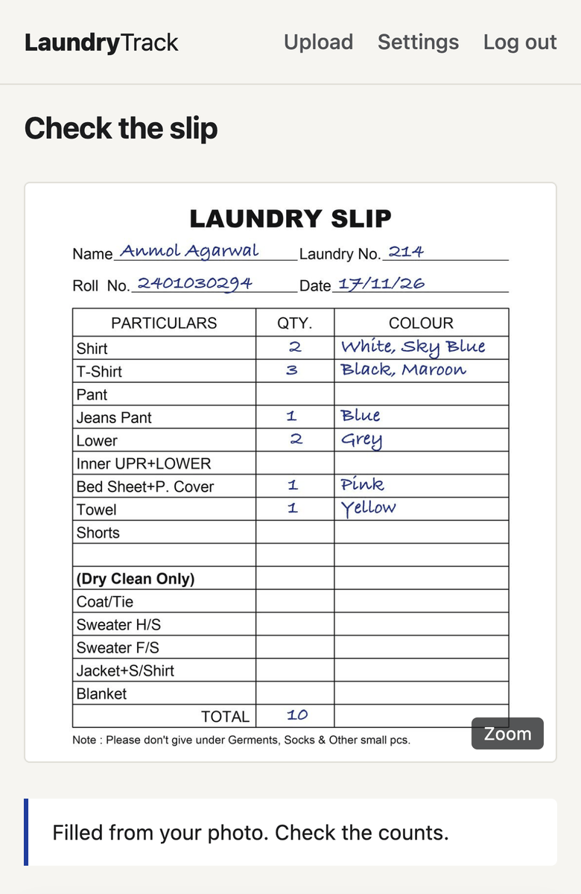
  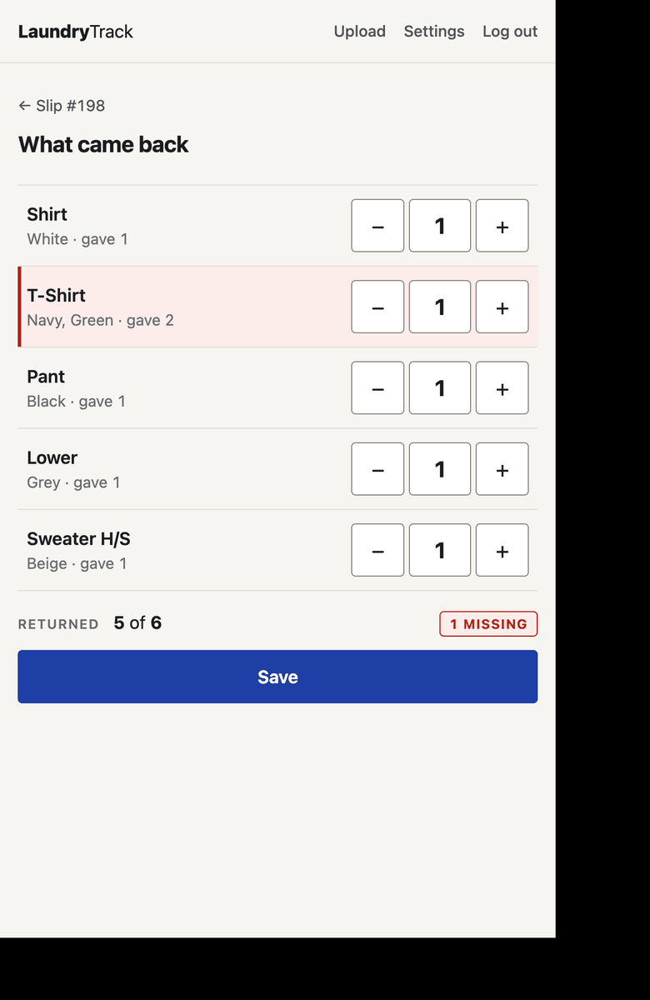
</p>
<p align="center"><sub>Upload, check and collect at 390 px wide. The whole flow is meant to be done standing at the laundry counter.</sub></p>

## How it works

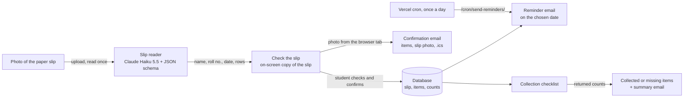

| Piece | What it does |
|---|---|
| Django views and templates ([`laundry/views.py`](laundry/views.py), [`laundry/templates/`](laundry/templates)) | Sign-up and login, upload, the check page, the slip page, collection, settings and the slips list. Server-rendered pages with a little JavaScript for the photo preview, zoom and the collection counters. |
| Slip reader ([`laundry/services/extract.py`](laundry/services/extract.py)) | Resizes the photo, sends it to Claude Haiku 5.5 with a prompt that describes the JIIT slip and a JSON schema for the answer, then cleans the result (dates to ISO, quantities to integers, duplicate rows merged). It never raises: if reading fails, the check page opens empty for you to fill in by hand. Without an API key it falls back to a locally installed, logged-in Claude Code CLI. |
| Slip layout ([`laundry/forms.py`](laundry/forms.py)) | The printed rows of the paper slip, in order, used to lay the on-screen copy out like the paper one. |
| Laundry days ([`laundry/services/schedule.py`](laundry/services/schedule.py)) | Works out the earliest reminder date from the slip date and the student's own laundry days. |
| Email ([`laundry/services/mailer.py`](laundry/services/mailer.py)) | Confirmation, reminder and collection emails, built from inline-styled tables so they render in Gmail, plus the `.ics` calendar file and the Google Calendar link. |
| HTTPS mail relay ([`laundry/services/relay_backend.py`](laundry/services/relay_backend.py), [`mail_relay.example.gs`](mail_relay.example.gs)) | Campus networks block the SMTP ports (25, 465 and 587), so the app can post each email as JSON over HTTPS to a small Google Apps Script web app, which sends it from the owner's Gmail. Gmail SMTP with an app password also works where the ports are open. |
| Reminders ([`laundry/services/reminders.py`](laundry/services/reminders.py), [`vercel.json`](vercel.json)) | A Vercel cron job calls `/cron/send-reminders/` once a day with a shared secret, and the app emails every slip whose reminder date is today. Locally the same job runs as `python manage.py send_pickup_reminders`. |
| Database | Postgres in production (any `DATABASE_URL`), SQLite locally. |

## Privacy and limits

- **Slip photos are not stored on the server.** The upload is written to a temporary file, read, and deleted. The copy shown on the check page lives in your browser tab, and the copy you keep is the one attached to your confirmation email.
- **What is stored:** your account (name, username, roll number, institute email, hostel, room, laundry days) and, for each slip, the fields read from it, the items with quantities and colours, the returned counts, the dates and the status. The reader's raw answer is kept with the slip too.
- **Email goes to the roll number written on the slip**, at `@mail.jiit.ac.in`. If the roll number is misread or mistyped, the email, including the slip photo, goes to another student. That is why nothing is sent until you have checked the slip and confirmed, and why the page shows the address before you confirm.
- **Daily caps per user:** 10 slip reads and 20 emails a day by default, set with `LAUNDRY_DAILY_UPLOAD_LIMIT` and `LAUNDRY_DAILY_EMAIL_LIMIT`. They keep one account from running up the AI bill or the Gmail sending quota.
- **The AI can misread handwriting.** A 1 that looks like a 7, a colour it cannot make out, a row it skips. The check step exists for this, and the record is only as good as the check you do before confirming.
- **Reminders are not exact to the minute.** On Vercel's free plan a cron job runs once a day, at some point within the hour it is scheduled for (08:00 UTC, which is 1:30 PM in India, before the counter opens).
- **Built for JIIT.** The slip layout the reader is told about, the printed rows, the email domain, the default laundry days and the counter hours are all JIIT's. They live in [`extract.py`](laundry/services/extract.py), [`forms.py`](laundry/forms.py) and [`settings.py`](laundrytrack/settings.py) and can be changed in code; there is no admin screen for them.
- **It is a record, not a contract.** The laundry staff do not use the app. What it gives you is a dated email with the slip photo and a written count at pickup, which is more than the paper slip alone, but it does not settle a dispute on its own.

## Run it locally

You need Python 3.12.

```bash
git clone https://github.com/iAnmolAgarwal/laundrytrack.git
cd laundrytrack
python3 -m venv .venv
source .venv/bin/activate
pip install -r requirements.txt
cp .env.example .env          # then add your ANTHROPIC_API_KEY
python manage.py migrate
python manage.py runserver    # open http://127.0.0.1:8000
```

On macOS, `./run.sh` runs the migrations and the server in one step and also prints an address you can open from a phone on the same Wi-Fi.

- **With no mail settings** in `.env`, nothing is sent: every email is written as a file to `sent_emails/`, so you can read exactly what would have gone out.
- **With no `ANTHROPIC_API_KEY`**, the app tries a locally installed, logged-in Claude Code CLI to read the slip. If that is not there either, the check page opens empty and you fill in the slip by hand; everything else works.

## Deploy your own

1. Import the repository into Vercel. [`vercel.json`](vercel.json) sets the framework to Django, and Vercel serves the project through `laundrytrack/wsgi.py`.
2. Create a Postgres database (for example Neon from the Vercel Marketplace) and set its connection string as `DATABASE_URL`.
3. Set the environment variables from [`.env.example`](.env.example): `ANTHROPIC_API_KEY`, `DJANGO_SECRET_KEY`, `CRON_SECRET`, and either `MAIL_WEBHOOK_URL` and `MAIL_WEBHOOK_TOKEN` or `EMAIL_HOST_USER` and `EMAIL_HOST_PASSWORD`. If you use a custom domain, add it to `ALLOWED_HOSTS`.
4. Create the tables by running `python manage.py migrate` from your machine with `DATABASE_URL` pointing at the production database.
5. The cron entry in [`vercel.json`](vercel.json) calls `/cron/send-reminders/` once a day; Vercel sends `CRON_SECRET` with it, and the endpoint refuses any call without it.
6. For the HTTPS mail relay, follow the steps at the top of [`mail_relay.example.gs`](mail_relay.example.gs): paste it into a new Apps Script project, set the token, deploy it as a web app, and put the web app URL and the token in `MAIL_WEBHOOK_URL` and `MAIL_WEBHOOK_TOKEN`.

## Tests

```bash
python manage.py test laundry
```

The 19 tests cover the laundry-day arithmetic (Tuesday to Friday, Friday to the next Tuesday, per-student days, counter hours), the full upload, confirm and collect cycle with the slip reader stubbed out (including who the email goes to and that the calendar file is attached), a blank slip staying blank, the checks on roll number, items and reminder date (never before the next laundry day, never in the past, and following a change of laundry days), a new upload replacing an earlier unconfirmed one (only one unconfirmed upload is kept per student), the daily cap on slip reads, one student not seeing another's slip, the institute-email rule at sign-up, and the cron endpoint's secret and its choice of which reminders are due.

## Credits

Built by Anmol Agarwal, a student at JIIT Noida, to fix a problem from his own hostel.

## Licence

[MIT](LICENSE)
